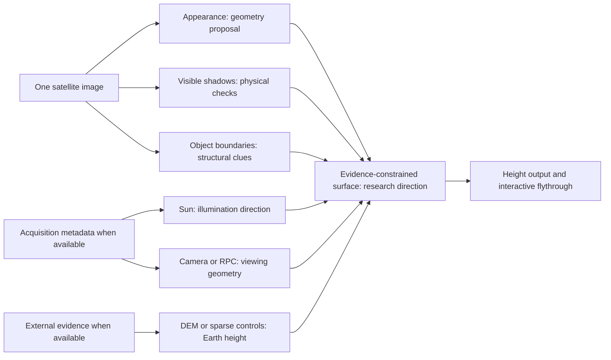
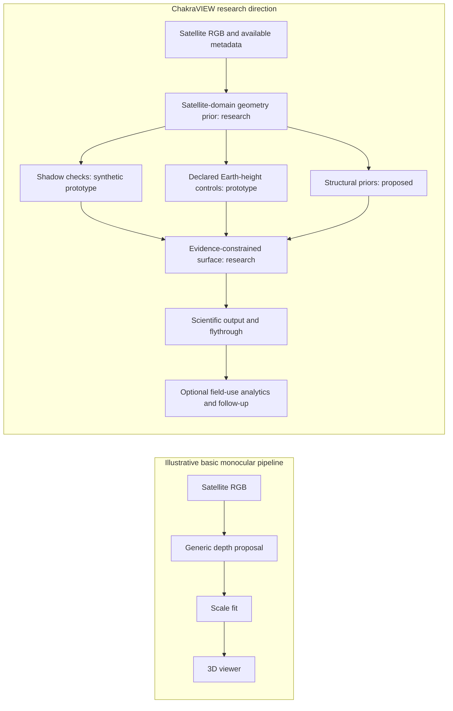
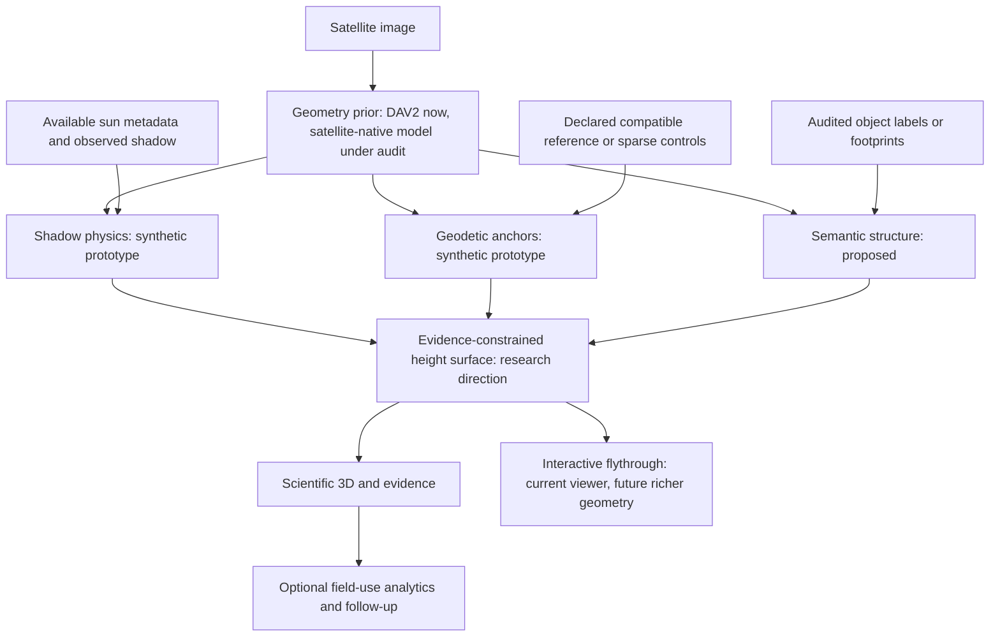

# ChakraVIEW SIH26175: innovation research and presentation strategy

Research checked 27 September 2026. Scope: one overhead image, height/3D reconstruction and interactive flythrough. This brief proposes a research direction, not a new production release. No model evaluation/training, source-code change, dataset alteration or large system implementation occurred.

## 1. Executive recommendation

**Main technical idea: a 3D surface that can be checked against the shadow in its source image.**

Judge explanation: “AI proposes the shape. We check whether that shape would cast the shadow in the image. Trusted elevation points place the shape at the right height on Earth.”

Use three visible status labels on the technical slide: CURRENT APPLICATION, SYNTHETIC PROTOTYPE, RESEARCH DIRECTION. Keep future capabilities visibly labelled. The novelty pitch is the integration and evidence discipline. We did not invent monocular depth, shadow photogrammetry, geodetic control, inverse rendering or next-best-view.

The strongest defensible central thesis is: **A satellite observation offers geometry clues beyond visual appearance, when its acquisition metadata and supporting measurements are available.** Sun/RPC metadata, external DEMs and elevation anchors are not contained in RGB pixels. One image plus these inputs is still a single-image reconstruction workflow, but it is not an RGB-only method.

Scout is the secondary extension: when the reconstruction remains ambiguous, rank the next useful observation. Keep response routing/change analytics separate from the core height/flythrough story.

## 2. Repository evidence and claim boundaries

Verified branch: `research/geoguard-sprint`. Pre-existing status: `.gitignore` modified, `research/` untracked. No production tests were rerun for this documentation task. Historical counts are not presented as fresh regression results.

Evidence inspected:

- `README.md`: implemented DAV2 Small, relative mode, compatible-reference affine DSM calibration, separate validation, previews, MissionView, Orbit/Fly and unit-aware measurement workflows.
- `backend/services/depth_pipeline.py`: current preview/metric-reference metadata path.
- `frontend/src/components/MissionViewAnalysis.jsx`: current fly/measurement code.
- `research/geoguard/GEOINVERSE_PHYSICS_ENGINE.md` and `geoinverse_physics/`: synthetic robust anchor fitting, offset/affine/optional plane, geometric shadow renderer, mismatch and constraint registry. The documented optimizer searches simple synthetic scale/offset parameters. No full-raster real-scene inverse renderer is established.
- `GEOINVERSE_V0_RESULTS.md`, `GEOINVERSE_V1_RESULTS.md`, `GEOINVERSE_V1A_SUPPORT_PROJECTION.md`: V0/V1 NO-GO, V1A diagnostic answer NO. Do not sell learned detail fusion as successful. V1 region-equal MAE 4.470300 m versus reference 4.382543 m. This is research evidence of failure, not a production metric or final withheld validation update.
- `chakraview_scout/VALIDATION.md` and `outputs/results.json`: synthetic planning prototype, 46 Python tests and 40 DOM-stub JavaScript assertions recorded. No real field validation or browser visual QA established.
- `CANONICAL_PILOT_TRANSFER_MANIFEST.json`: unchanged development pilots and exact baseline verification. These four counties are not independent final-test geographies.

Manish owns foundation-model evaluation. No model winner or completed GeoRay/Sat3DGen integration is inferred from parallel work. Ayush owns response analytics. This brief treats those interfaces as supplied layers and does not duplicate them.

## 3. Recent primary-source research scan

Source summaries below distinguish published papers, preprints and author repositories. External results never become ChakraVIEW results. No weights were downloaded. Publisher access was limited for some papers, so those entries use accessible primary publisher abstracts/search extracts and explicitly avoid unsupported implementation details.

### R1. GeoRay: Gauge-Aware Feed-Forward Satellite 3D Reconstruction in the Geodetic Frame

- Year/status: 2026, arXiv v1 dated 30 August. [Paper](https://arxiv.org/html/2608.29680v1), [official repository](https://github.com/HIT-SIRS/GeoRay).
- Problem: absolute satellite surface height under RPC cameras rather than perspective-camera depth.
- Core idea/novelty: ray-consistent adaptation of frozen geometry backbones, relief/datum separation and uncertainty-aware combination of monocular and multiview streams.
- Inputs: **three satellite views with their RPCs** in the published setup, plus optional declared elevation controls. Zero/one/sparse control does not mean zero/one/sparse imagery.
- Output: Earth-referenced predicted surface-height field and model uncertainty.
- Learn/adapt: separate shape from vertical placement, disclose control budgets, score coverage alongside error. Treat this as architectural inspiration and Manish's audit candidate.
- Must not claim: GeoRay is a drop-in one-RGB model, its reported errors apply to ChakraVIEW, or RPCs alone guarantee correct absolute elevation. Code release exists, but release/integration suitability is not benchmarked here.

### R2. Sat3DGen: Comprehensive Street-Level 3D Scene Generation from Single Satellite Image

- Year/status: ICLR 2026, [paper](https://arxiv.org/html/2605.14984v1), [author repository](https://github.com/qianmingduowan/Sat3DGen).
- Problem: overhead-to-street viewpoint gap and weak geometry in generated scenes.
- Core idea/novelty: geometry-first constraints and perspective-view training for single-image scene generation.
- Inputs: single satellite image for the released reconstruction path. Some video modes also use sky imagery and trajectories.
- Outputs: learned 3D representation, textured mesh and novel-view renderings. Paper includes satellite-view DSM prediction.
- Learn/adapt: benchmark geometric fidelity separately from appearance, and make immersive flythrough secondary to authoritative height.
- Must not claim: generated façades/hidden objects are observed, a plausible mesh is survey truth, or predicted metric depth automatically carries ChakraVIEW's geodetic datum.
- Practical note: author repository advertises CUDA inference and approximately 1.5 GB checkpoints. No download, execution or accuracy verification performed here.

### R3. EO-VGGT: Orbital Ray-Conditioned 3D Foundation Models for Satellite Multi-View Reconstruction

- Year/status: July 2026 preprint, explicitly under review. [Primary abstract](https://arxiv.org/abs/2607.00417).
- Problem: perspective foundations do not naturally represent pushbroom rays and heterogeneous satellite view sets.
- Core idea/novelty: geometry/radiometry-informed view selection, sensor-ray encoding and lightweight adapters into a frozen backbone.
- Inputs: multiple optical satellite observations and rational-function sensor geometry.
- Output: satellite reconstruction geometry suitable for surface modelling.
- Learn/adapt: sensor metadata matters. Preserve an optional multiview upgrade lane without redefining SIH's single-view core.
- Must not claim: single-image proof, a completed ChakraVIEW integration, or performance validated on our pilots.

### R4. Gaussian Splatting for Efficient Satellite Image Photogrammetry / EOGS

- Year/status: CVPR 2025, earlier preprint titled EOGS: Gaussian Splatting for Earth Observation. [CVPR paper](https://openaccess.thecvf.com/content/CVPR2025/papers/Aira_Gaussian_Splatting_for_Efficient_Satellite_Image_Photogrammetry_CVPR_2025_paper.pdf).
- Problem: expensive reconstruction from satellite images acquired at different dates/viewpoints.
- Core idea/novelty: adapt Gaussian splatting with radiometric and shadow modelling, consistency and regularization for Earth observation.
- Inputs: multiple satellite images, camera and illumination geometry with per-scene optimization.
- Outputs: scene appearance and elevation geometry.
- Learn/adapt: illumination consistency is useful physical evidence and rendering speed matters for flythrough.
- Must not claim: a one-image reconstruction result, our shadow code reproduces EOGS, or a convincing rendering proves a correct DSM.

### R5. EOGS++: Earth Observation Gaussian Splatting with Internal Camera Refinement and Direct Panchromatic Rendering

- Year/status: November 2025 preprint. [Paper](https://arxiv.org/abs/2511.16542).
- Problem: preprocessing and camera errors limit satellite reconstruction.
- Core idea/novelty: direct panchromatic rendering and internal camera refinement, with reconstruction/postprocessing changes.
- Inputs: satellite observation sets and sensor information, including panchromatic data.
- Outputs: optimized scene and elevation products.
- Learn/adapt: treat camera/radiometric mismatch as error sources rather than forcing all discrepancy into surface height.
- Must not claim: our RGB-only app already handles raw PAN or bundle adjustment. Multiview inverse reconstruction is an extension, not the required single-view solution.

### R6. RPC-GS: Gaussian Splatting with native RPC Rendering for Satellite Imagery

- Year/status: June 2026 preprint. [Paper](https://arxiv.org/abs/2606.06690).
- Problem: camera approximations can distort satellite Gaussian reconstruction.
- Core idea/novelty: project Gaussian geometry through native RPC coordinate mappings and Jacobians, with ray-based metric depth.
- Inputs: satellite imagery and RPC sensor models for scene reconstruction.
- Outputs: rendered 3D representation and reconstructed geometry.
- Learn/adapt: an RPC-aware rendering lane could make future physical checks consistent with the satellite camera.
- Must not claim: native RPC rendering alone solves monocular height ambiguity or this renderer is implemented in ChakraVIEW.

### R7. Enhancing Monocular Height Estimation via Sparse LiDAR-Guided Correction

- Year/status: May 2025 preprint. [Full paper](https://arxiv.org/html/2505.06905v1).
- Problem: synthetic-trained height predictions can depend on shadows and carry scene-specific error.
- Core idea/novelty: inspect shadow sensitivity, preprocess ICESat-2 evidence, and learn residual corrections using sparse measurements and image features.
- Inputs: VHR imagery, monocular predictions and ICESat-2 photons with classification/normalization support.
- Output: corrected heights, with examples in Saint-Omer, Tokyo and São Paulo.
- Learn/adapt: sparse measured controls are valuable, but datum, class, timing and horizontal alignment matter. Shadow checks are physically interpretable, not automatically statistically independent of AI.
- Must not claim: our robust offset fitter reproduces this learned correction. Model-guided registration requires separate independent checks and must never use withheld scoring truth for tuning.

### R8. Urban Building Footprints Extraction and Heights Estimation from High-Resolution Spaceborne Remote Sensing Imagery Using a CNN-Transformer Network

- Year/status: 2026, Remote Sensing 18(10), 1484. [Publisher](https://www.mdpi.com/2072-4292/18/10/1484). Full-page access encountered rate limiting, while the primary publisher search extract exposed its geometry section.
- Problem: link extracted buildings/shadows to height in high-resolution imagery.
- Core idea/novelty: combine footprint/shadow extraction with sun/sensor geometry, distinguishing fully visible and partially occluded ground shadows.
- Inputs: high-resolution spaceborne imagery, extracted object/shadow regions, sun and sensor angles.
- Output: building footprints and estimated building heights.
- Learn/adapt: use acquisition geometry and object-shadow association rather than apply length-times-tangent universally.
- Must not claim: every roof casts a measurable ground shadow, one case-specific scalar correction handles all terrain, or this network is integrated.

### R9. 3D building reconstruction from monocular remote sensing imagery via diffusion models and geometric priors

- Year/status: ISPRS Journal, volume 232, February 2026, DOI contains 2025. [Publisher](https://www.sciencedirect.com/science/article/pii/S0924271625004563), [DOI](https://doi.org/10.1016/j.isprsjprs.2025.11.018).
- Problem: roof/facade confusion and weak single-view contour/height estimation.
- Core idea/novelty: DG-BRF combines diffusion-related contour reasoning and geometric priors for monocular building reconstruction.
- Inputs: monocular remote-sensing imagery with learned/geometric building information.
- Output: reconstructed building footprints/height geometry.
- Learn/adapt: object boundaries and structural priors can stabilize mesh interpretation.
- Must not claim: unrestricted hidden-façade recovery, reliable heights from generative appearance, pretrained weights availability, or a completed integration. Access was limited to primary publisher extracts, not full methods/code.

### R10. Synergistic Semantic Segmentation and Height Estimation for Monocular Remote Sensing Images via Cross-Task Interaction

- Year/status: May 2025, Remote Sensing 17(9), 1637. [Publisher](https://www.mdpi.com/2072-4292/17/9/1637).
- Problem: semantic and height tasks have useful shared features but also task-specific needs.
- Core idea/novelty: CTME-Net's task-specific distillation and cross-task feature interaction jointly predict semantic classes and heights.
- Inputs: monocular remote-sensing imagery with supervised training labels.
- Output: semantic maps and height maps.
- Learn/adapt: use object class as a soft constraint, not a fixed class-to-height lookup.
- Must not claim: semantic labels uniquely determine height, the network enforces our proposed water/roof rules, or pretrained integration is verified. Description relies on primary publisher extracts due rate limiting.

### R11. HeightCLIP: A vision-language network for height estimation from monocular remote sensing imagery

- Year/status: August 2026, International Journal of Applied Earth Observation and Geoinformation 152, 105499. [Publisher](https://www.sciencedirect.com/science/article/pii/S1569843226004152).
- Problem: visual-only height estimation underuses height-related semantic cues.
- Core idea/novelty: interval-based prompting and cross-modal feature alignment for height prediction.
- Inputs: remote-sensing imagery and a trained vision-language framework.
- Output: predicted height maps.
- Learn/adapt: semantic supervision can inform height intervals and structure, alongside geometric checks.
- Must not claim: an LLM can read exact building height from a picture, language replaces physical measurements, or downloadable weights/offline integration were verified. Assessment here is abstract-level, not replication.

### R12. The First Assessment of PhiSat-2 Imagery for Monocular Building Height Estimation

- Year/status: 2026 preprint v3, revised 22 June. Earlier v1 used the title Monocular Building Height Estimation from PhiSat-2 Imagery: Dataset and Method. [Current version](https://arxiv.org/abs/2603.29245).
- Problem: building heights at intermediate-resolution satellite spatial/spectral scales.
- Core idea/novelty: PHDataset and TSONet jointly use ordinal height and footprint guidance.
- Inputs: PhiSat-2 imagery at 4.75 m with seven multispectral bands, rather than arbitrary three-band RGB.
- Output: dense building-height estimates and auxiliary footprints.
- Learn/adapt: resolution and spectral requirements must be explicit when selecting satellite-native models.
- Must not claim: an RGB drop-in replacement, exact individual-building detail at any resolution, or proven transfer to Kerala imagery.

### R13. A flexible framework for built-up height mapping using ICESat-2 photons and multisource satellite observations

- Year/status: Remote Sensing of Environment, March 2025. [Publisher](https://www.sciencedirect.com/science/article/abs/pii/S0034425724005984).
- Problem: sparse urban building-height labels at large scale.
- Core idea/novelty: derive photon-based height samples and aggregate them for multisource regression.
- Inputs: ICESat-2, Sentinel observations and DSM support.
- Output: built-up height mapping, with optimal aggregation around 300 m in that study.
- Learn/adapt: sampling support and resolution matter as much as the model.
- Must not claim: 300 m urban statistics give individual rooftop heights, or every photon is a correct ground anchor.

### Established foundations, not falsely labelled recent

[Bircher et al., Receding Horizon Next-Best-View Planner for 3D Exploration (ICRA 2016)](https://github.com/ethz-asl/nbvplanner) motivates follow-up observation selection. Scout adapts a greedy raster visibility/uncertainty proxy, not the paper's full 3D robotic planner. [GDAL viewshed documentation](https://gdal.org/en/stable/programs/gdal_raster_viewshed.html) provides established terrain-visibility context. These support the secondary extension, not the single-image geometry proof.

## 4. Ten candidate innovations

Each idea has exactly one primary maturity category. Difficulty and visual impact are editorial estimates, not measured engineering timelines.

### I1. Independent shadow-height check

- Simple explanation: measure an object's ground shadow to check the AI's proposed height.
- Different: a declared physical measurement complements appearance-based inference.
- Basis/inputs: cast-shadow geometry, correct image-date sun angles, object base/roof/shadow correspondence, metric pixel geometry and local receiver terrain, plus sensor geometry when needed.
- Output: object-level height estimate/residual with an unknown/ambiguous flag.
- Status: PROPOSED. The renderer exists, but no real-image shadow extraction/height measurement pipeline is established.
- Difficulty: HIGH. PPT impact: HIGH. Scientific risk: HIGH.
- Claim today: physically grounded check we propose adding. Cannot claim reliable building/terrain heights from arbitrary shadows.

### I2. Shadow re-rendering self-check

- Simple explanation: ask whether the proposed 3D surface would cast the shadow seen in the image.
- Different: tests a reconstruction by a forward physical prediction.
- Basis/inputs: candidate metric surface, sun geometry and independently audited observed shadow support.
- Output: predicted shadow, mismatch map and constraint objective.
- Status: PROTOTYPED / SYNTHETICALLY VALIDATED.
- Difficulty: HIGH for real imagery/full-surface optimization. PPT impact: VERY HIGH. Risk: HIGH.
- Claim today: discrete renderer and combined-objective tests on deterministic synthetic terrain. Cannot claim real-satellite improvement, unique reconstruction or arbitrary raster optimization.

### I3. Sparse geodetic gauge recovery

- Simple explanation: trusted elevation points place the AI shape at the right height on Earth.
- Different: handles vertical placement explicitly rather than interpreting raw depth as metres.
- Basis/inputs: matched metric-height controls with datum/units/uncertainty and a compatible surface parameterization.
- Output: offset, affine or declared plane correction plus anchor residuals.
- Status: PROTOTYPED / SYNTHETICALLY VALIDATED.
- Difficulty: MEDIUM. PPT impact: HIGH. Risk: MEDIUM.
- Claim today: robust anchor/gauge machinery, controlled offset/scale recovery. Cannot claim one anchor resolves unknown scale or repairs all local structure. ICESat-2 ingestion remains proposed.

### I4. Shape and absolute-elevation separation

- Simple explanation: solve local shape and vertical placement as different questions.
- Different: reveals what the image can constrain versus what external reference must supply.
- Basis/inputs: explicit decomposition Z = G + R and valid controls/reference; masked low-pass choice is caller-declared.
- Output: coarse/gauge component and relative-relief component with separate evidence bookkeeping.
- Status: PROTOTYPED / SYNTHETICALLY VALIDATED.
- Difficulty: MEDIUM. PPT impact: HIGH. Risk: MEDIUM.
- Claim today: decomposition/gauge code exists. Cannot claim all gauges reduce to an offset or a coarse DSM perfectly describes ground.

### I5. Satellite-native geometry prior

- Simple explanation: use overhead-trained geometry and available sensor metadata instead of assuming phone-camera geometry.
- Different: addresses nadir/pushbroom/RPC/domain mismatches explicitly.
- Basis/inputs: model-specific imagery, scale and possibly RPCs/multiple views. GeoRay/EO-VGGT are multiview; Sat3DGen is directly single-image but generative.
- Output: satellite-domain geometry proposal with provenance and declared output type.
- Status: IN ACTIVE RESEARCH. Manish's audit owns selection.
- Difficulty: VERY HIGH. PPT impact: HIGH. Risk: HIGH.
- Claim today: evidence-backed research direction. Cannot claim selected/integrated model or borrowed external accuracy.

### I6. Semantic structural constraints

- Simple explanation: use object identity to test whether the proposed shape is reasonable.
- Different: constraints depend on what a surface represents rather than blanket smoothing.
- Basis/inputs: auditable class/footprint/roof labels with uncertainty, candidate height surface.
- Output: soft class-conditioned structural penalties and explanatory flags.
- Status: PROPOSED.
- Difficulty: HIGH. PPT impact: HIGH. Risk: HIGH.
- Claim today: feasible design with literature support. Cannot claim roads are always flat, roofs always planar or trees have one correct height.

### I7. Evidence-support and disagreement overlay

- Simple explanation: show where available clues support the surface and where they conflict.
- Different: transparent source-specific evidence instead of unexplained neural confidence.
- Basis/inputs: registry availability/constraint residuals and normalized supplied uncertainty proxies.
- Output: support/disagreement map and reason list.
- Status: PROTOTYPED / SYNTHETICALLY VALIDATED.
- Difficulty: MEDIUM. PPT impact: HIGH. Risk: MEDIUM.
- Claim today: research registry and Scout named-evidence fusion exist. Cannot claim calibrated confidence, statistical independence or live production overlays.

### I8. Protected coarse terrain with evidence-gated detail

- Simple explanation: retain broad Earth relief and accept fine corrections only where independent evidence supports them.
- Different: explicitly guards against damaging a good reference with learned corrections.
- Basis/inputs: known coarse reference support, detail proposal, input-valid masks, independent controls and preregistered acceptance rule.
- Output: scale-separated surface and reject/retain decisions.
- Status: IN ACTIVE RESEARCH, with negative V0/V1/V1A evidence.
- Difficulty: HIGH. PPT impact: HIGH. Risk: HIGH.
- Claim today: tested safeguards exposed a weak signal and stopped integration. Cannot claim successful fine-detail recovery or that frequency separation alone fixes hallucination.

### I9. Height change with shared geodetic control

- Simple explanation: compare before/after surfaces only after verifying they share the same frame and support.
- Different: focuses on geometry change rather than visual change alone.
- Basis/inputs: two separately reconstructed surfaces, matching vertical datum, checked registration/epoch, validity and uncertainty.
- Output: Delta Z and, only where justified, area-integrated volume with uncertainty.
- Status: PROPOSED.
- Difficulty: VERY HIGH. PPT impact: HIGH. Risk: HIGH.
- Claim today: future extension design. Cannot claim accurate collapse/damage/material volumes from unconstrained monocular surfaces.

### I10. Follow-up observation for ambiguous geometry

- Simple explanation: recommend where an additional observation could clarify important reconstruction uncertainty.
- Different: links evidence gaps to human-guided follow-up rather than passively displaying a surface.
- Basis/inputs: terrain, named uncertainty/relevance evidence, viewshed and supplied access constraints.
- Output: ranked viewpoints and score decomposition.
- Status: PROTOTYPED / SYNTHETICALLY VALIDATED.
- Difficulty: MEDIUM for synthetic prototype, HIGH for operational validation. PPT impact: HIGH. Risk: HIGH operationally.
- Claim today: Scout's deterministic viewshed/ranking/loop and comparisons. Cannot claim real-world information gain, safe navigation, optimal flight or rescue effectiveness.

## 5. Deep physical and geometric assessment

### A. Building shadows versus terrain shadows

For a vertical object over a horizontal receiving plane, the true base-to-shadow-tip ground length L gives `h = L tan(alpha_sun)`. Measure length in ground metres, not arbitrary image pixels. Sun azimuth defines the shadow direction and helps associate a roof/base with its shadow. Clouds, dark roofs, water and overlapping shadows can defeat association.

A more general formulation uses a roof point P and intersects `P + t d_sun` with the receiving terrain, then projects both roof/shadow points through the actual camera. Fit height by the projected residual. This includes changing receiver slope, roof geometry and sensor occlusion rather than applying one universal scalar formula.

For a local flat-ground parallel-camera approximation, define unit horizontal directions `u_s` and `u_v` toward sun and sensor, with elevations alpha_s and alpha_v. Ground shadow displacement from the true base is `-h cot(alpha_s) u_s`. Apparent roof displacement on a ground-plane projection is `-h cot(alpha_v) u_v`. If the observable vector d goes from projected roof point to ground shadow tip, then:

`d = h a`, with `a = -cot(alpha_s) u_s + cot(alpha_v) u_v`.

Least-squares height is `h = (d dot a)/(a dot a)` only when endpoints/assumptions are valid. This is an explanatory local derivation, not a coded universal satellite inversion. Near-zero a is ill-conditioned. For real pushbroom acquisitions use RPC projection/localization and visibility, not an invented global pinhole camera. A GeoTIFF affine transform or EPSG code is not an RPC model. Orthorectification can displace roof pixels and may already depend on a reference DEM. Original sensor metadata/orthorectification provenance are needed for those corrections.

On terrain with slope g_q along the ground shadow direction, planar approximation gives `h = L(tan(alpha_s) + g_q)`. A rising receiver shortens the shadow. General relief requires terrain ray intersection. Building height above local base differs from absolute roof elevation and from a DSM's elevation datum.

**Building heights:** useful when roofs/bases/receivers and cast shadows can be matched. **Terrain relief:** shadow extent can constrain ridge/valley relationships via forward rendering, but a shadow does not directly give absolute ground elevation. A uniform vertical shift leaves cast terrain shadows unchanged. **Both:** complementary relief clues under adequate metadata/coverage, not unique dense-height recovery.

Illustrative calculation only: L=30 m and sun elevation 20 degrees imply h about 10.92 m on a flat receiver. With length uncertainty 1 m and angle uncertainty 1 degree, first-order independent error propagation gives about 0.70 m before segmentation, camera, slope and model errors. It is not observed ChakraVIEW accuracy. Formula: `sigma_h^2 = (tan(alpha) sigma_L)^2 + (L sec(alpha)^2 sigma_alpha)^2`, angles in radians.

### B. Self-checking through re-rendering

Show source image/shadow mask, proposed surface, simulated shadow and disagreement overlay. Explain: “If the ridge is too tall, its simulated shadow reaches the wrong place.” Existing GeoInverse Physics implements a nearest-cell terrain shadow renderer and mismatch objective. It omits atmosphere, penumbra, translucent vegetation, overhangs and camera rendering. Its synthetic observed shadow uses the same renderer, so it tests software consistency, not independent optical fidelity.

A future real test must obtain one dated, clear high-resolution scene with sun metadata, an independently audited shadow mask and a terrain halo. Use separate sparse fitting anchors and spatially disjoint LiDAR check points. Freeze objective weights before testing. Compare unchanged prior, anchors only, shadow constraint only and combined constraints. Report height error and shadow agreement separately. A lower shadow mismatch can accompany incorrect geometry. Darkness/shading alone also depends on albedo, reflectance, atmosphere and sun, so full photometric inverse rendering is harder than binary cast-shadow consistency. EOGS/NeRF-style successes with many images do not solve the one-image ambiguity.

### C. Zero, one and sparse anchors

- Zero anchors: relative geometry remains ambiguous unless another declared metric/geodetic source constrains it. A pretrained metric prior is a learned prediction, not observed absolute elevation.
- One anchor: fixes an additive offset if scale and other gauge components are already known. It cannot determine two unknown parameters a,b in `Z=aD+b`.
- Two controls with sufficiently distinct D: can identify affine scale/offset mathematically, but more well-distributed controls are needed for robustness and independent checks.
- Additive plane: at least three non-collinear spatial controls and full-rank design are needed. Dense local errors remain unresolved.
- Sparse ICESat-2: proposed provider-specific ingestion, not yet integrated. Check photon quality, ground/roof/canopy classification, horizontal uncertainty, epoch, ellipsoidal versus orthometric datum and sampling footprint before treating heights as controls. An ICESat-derived roof-minus-ground height is not interchangeable with absolute ground elevation.

### D. Coarse Earth level and local shape

`Z = G + R` is a representation choice. For a trusted coarse reference G, learn/check only the detail R supported by the image and evidence. Offset corrections preserve relief amplitude; affine corrections deliberately change it. A spatial plane can change broad tilt. No representation automatically creates real rooftop signal or chooses the correct datum.

### E. Satellite-native versus generic geometry

Near-nadir views lack familiar ground-camera perspective, maps vary in resolution/orthorectification, and native pushbroom rays differ from pinhole rays. Prefer a model evaluated at the actual input domain and output type. An orthophoto without RPC metadata cannot satisfy a native-RPC model contract. Current DAV2 remains the implemented baseline. GeoRay is conceptual inspiration and a conditional multiview candidate; Sat3DGen provides the direct single-image scene-generation connection; neither is a proven project replacement today.

### F. Semantics without invented structure

Treat water-level consistency as a local soft constraint subject to flow/tides/datum. Roads can slope, bridge decks can disconnect from terrain, roofs can be pitched or multilevel, and vegetation is a season-dependent upper surface. Footprints may describe ground outline while imagery shows displaced roof outline. Use semantic uncertainty to attenuate priors. Never fill occluded/unknown areas and then label the invented geometry measured.

### G. Agreement is support, not calibrated confidence

Several clues can share bias. A monocular model may already use shadows, a reference may influence orthorectification, and semantic labels may use the same image/model. Four agreeing clues are not four independent measurements automatically. Report source, coverage, residual, units, dependency and conflicting evidence. A calibration study is needed before calling an index a probability or a confidence percentage.

### H. Frequency safeguards informed by our failed experiments

Global/gauge correction and high-frequency detail must have separate evidence and constraints. Spatial modulation of a high-pass correction can reintroduce low-frequency drift. V1A's exact support-cell mean conservation removed one drift mechanism but did not recover sufficiently useful detail. Therefore preserve the good reference by default and reject unsupported detail. No further refiner training or improved detail result is claimed here. Calibration/reference surfaces and scoring truth remain separate.

### I. Change and volume

`Delta Z = Z_after - Z_before`, over common valid, compatible surface semantics. With cell area A, volume proxy `sum(Delta Z A)` needs actual metric heights and appropriate material/region interpretation. Vertical bias/registration, tree season, illumination and roof displacement can mimic change. Difference uncertainty includes both dates and covariance, not only one model's confidence. Use “candidate vertical change for verification”, not “confirmed damage” or “removed rubble volume”.

### J. Follow-up observations

Scout's synthetic ranking is already implemented under research. A real field/drone observation can provide verified controls, shadow interpretation or a better view of uncertain geometry. It remains a secondary benefit of the reconstructed surface. It does not make the initial single image uniquely solvable, and its simulated retention multiplier is not a measured sensor update.

## 6. Best five PPT innovations

The explanations below each contain exactly 15 whitespace-delimited words. Suggested headlines are plain labels, not new product brands.

1. **Satellite-aware geometry**
   - 15 words: “We investigate geometry models built for overhead imagery while preserving each model's actual input requirements.”
   - Example: compare a model's nadir/orthophoto evidence before replacing DAV2.
   - Technical line: geometry prior must match camera domain, scale and DSM/nDSM/relative output contract.
   - Status: IN ACTIVE RESEARCH.
2. **Shadow-based surface checking**
   - 15 words: “We test whether a proposed surface casts the observed shadows under the recorded sunlight geometry.”
   - Example: an over-tall ridge casts a simulated shadow beyond the observed boundary.
   - Technical line: geometric forward shadow and observed-mask mismatch, combined with declared anchor losses.
   - Status: PROTOTYPED / SYNTHETICALLY VALIDATED. **Main technical wow factor.**
3. **Height anchored to Earth**
   - 15 words: “Trusted elevation anchors place relative shape in Earth's vertical frame without using withheld evaluation truth.”
   - Example: a trusted control fixes a known-scale surface's vertical offset.
   - Technical line: uncertainty-weighted robust gauge fitting with explicit units/datum and rank checks.
   - Status: PROTOTYPED / SYNTHETICALLY VALIDATED. Production compatible-reference affine calibration is a separate implemented mechanism.
4. **Object-aware structure**
   - 15 words: “We propose object-aware constraints that preserve plausible roofs and water surfaces without inventing hidden geometry.”
   - Example: a labelled water patch raises a warning about an unsupported local height ripple.
   - Technical line: uncertainty-weighted, class-conditioned soft regularization and boundary preservation.
   - Status: PROPOSED.
5. **Useful follow-up observations**
   - 15 words: “Scout ranks follow-up viewpoints by the operationally relevant uncertainty their terrain visibility could help resolve.”
   - Example: recommend a viewpoint that reveals uncertain relief relevant to a supplied response corridor.
   - Technical line: greedy viewshed-weighted evidence/relevance/novelty objective with supplied access cost.
   - Status: PROTOTYPED / SYNTHETICALLY VALIDATED. **Cherry on top.**

## 7. Claim ladder

Assign each major concept exactly once at this level. Splitting a feature's current and future versions is explicit, not maturity inflation.

### IMPLEMENTED NOW

- DAV2 Small relative inference and offline/cached adapter workflow.
- Compatible-reference affine calibration and metric artifact/provenance generation.
- Separate calibration-fit and independent-validation workflows with validity handling.
- MissionView heightfield, RGB preview/texture pathway, Orbit/Fly and guarded measurements.

### PROTOTYPED / SYNTHETICALLY VALIDATED

- I2 shadow re-rendering check and simple combined-objective parameter search.
- I3 robust sparse-control gauge fitting, without automatic ICESat ingestion.
- I4 explicit shape/gauge decomposition.
- I7 named evidence-support/disagreement machinery, without calibrated confidence.
- I10 Scout's synthetic viewshed/ranking/sequential loop and offline concept.

### IN ACTIVE RESEARCH

- I5 satellite-native foundation geometry selection/audit, no winning model asserted.
- I8 protected coarse/detail fusion, current learned-refiner family NO-GO.
- Real-scene physical consistency evaluation, not yet a completed accuracy result.

### FUTURE EXTENSION

- I1 automatic real-image object/shadow extraction and height checks.
- I6 semantic structural constraints.
- I9 geodetically consistent pre/post surface change.
- Provider-specific ICESat-2 ingestion, native-RPC inverse renderer and arbitrary full-surface optimization.
- Adaptive mesh/LOD, scientific-versus-immersive twin UI, richer profiles and dynamic illumination overlays where not already supported by current code.
- Generative unseen street views, with explicit synthetic separation from measurements.
- Real mobile deployment, verified observation assimilation and field safety validation.

## 8. Why one image can do more: ten-second visual

Caption: **One image, several geometry clues. Extra evidence is optional and declared.**

Do not place “SPARSE ELEVATION” or “RPC” inside the RGB-image box. These are supporting observations/metadata. Place a source/status caption under the surface: **Current viewer plus synthetic physics prototype. Real-scene combined reconstruction remains research.**

## 9. Architectural contrast with a generic monocular pipeline

Suggested copy: “A basic monocular workflow produces one depth proposal and renders it. ChakraVIEW already records calibration, units and independent evidence. Our research direction adds physical shadow checks and geodetic controls, with satellite-native priors under audit. Each output should explain which observations support its height.”

A conceptual comparison, not a claim about every competitor:

Do not describe this entire research chain as current production. Do not insult teams or suggest a fair comparison without benchmarking.

## 10. Flythrough innovation assessment

- **Adaptive mesh resolution:** SCIENTIFIC visualization, PROPOSED, MEDIUM difficulty. Use surface curvature/error bounds for geometry preservation, avoid triangulating nodata gaps. LOD approximations must never become the authoritative measurement grid.
- **Level of detail and tile streaming:** SCIENTIFIC visualization, PROPOSED, MEDIUM. Improve interactive display performance without claiming recovered detail. Freeze analytic raster independent of render resolution.
- **Texture draping:** SCIENTIFIC display, IMPLEMENTED pathway for RGB/preview. Texture adds appearance, not height evidence. Capture a current working screenshot before claiming visual QA on a particular scene.
- **Uncertainty/support overlay:** SCIENTIFIC display, PROPOSED production UI fed by I7 prototype. Explain support/disagreement and unknown areas without fabricated probabilities.
- **Scientific versus immersive twin:** PROPOSED, HIGH. Scientific twin uses actual reconstructed surface/provenance; immersive twin may use generated content with a permanent “synthetic” label. Measurements cannot read the generative layer.
- **Neural scene completion:** IMMERSIVE, PROPOSED, VERY HIGH. Hidden façades/occluded regions become plausible suggestions only. Keep unknown geometry unknown in the scientific product.
- **Generative street views:** IMMERSIVE, PROPOSED, VERY HIGH, informed by Sat3DGen. Visual realism is a separate metric from height accuracy. Do not mix generated façades into the metric mesh without independent verification.
- **Fly-to-point:** SCIENTIFIC interaction, PROPOSED, LOW/MEDIUM. Jump to an evidence discrepancy or anchor while retaining map orientation. Current manual Orbit/Fly is already implemented, but automatic evidence-directed fly-to is not established.
- **Elevation profile:** SCIENTIFIC, PROPOSED extension, MEDIUM. Sample the authoritative raster along a selected path with units/nodata, not screen pixels or generated terrain. Point height/slope tools are existing separate capabilities.
- **Dynamic sun/shadow simulation:** SCIENTIFIC consistency overlay if using actual geometry, PROTOTYPED renderer, proposed viewer integration. Other-time shadows are predictions, not acquired observations. Camera-local assumptions and sun-angle conventions stay visible.
- **Camera-path confidence tour:** SCIENTIFIC, PROPOSED, MEDIUM. A flythrough that visits unsupported areas makes limitations visible. It is a review aid, not evidence that the camera trajectory is field-safe.

Sat3DGen informs the immersive lane. EOGS/RPC-GS inform geometry/rendering consistency but generally require additional observations. Neither licenses calling completed unseen views measured reality.

## 11. Main technical slide

Title: **HOW WE MOVE BEYOND MONOCULAR DEPTH**

Speaker technical equation, not mandatory large slide copy:

`Z* = argmin_Z (lambda_F L_prior + lambda_S L_shadow + lambda_A L_anchor + lambda_G L_reference + lambda_R L_structure)`.

Use normalized/compatible losses, documented evidence support and caller-supplied units/datum. This describes the objective registry/research direction, not an implemented general optimizer. Mini hero example: two equal-looking surface proposals cast different shadows. Clearly label any such visual synthetic. A uniform offset does not change shadows, so show anchors solving that complementary ambiguity.

## 12. Six-slide SIH deck placement

These are exact content placements for a six-slide deck, including title and references. Preserve official template headings/order when applying them. The earlier WhatsApp template path was not readable in this session, so this brief does not certify official-template or guideline compliance and does not edit a PPTX.

1. **Title / project identity.** ChakraVIEW, SIH26175, official team/PS fields from the supplied template. One-line purpose: “Single-image height reconstruction and interactive 3D inspection.” One genuine current application screenshot. No speculative feature list.
2. **Idea / proposed solution.** The ten-second “one image, several clues” diagram. Four supporting messages: AI geometry proposal, shadow check, declared Earth-height reference, explainable output. Clearly distinguish existing RGB workflow from metadata/evidence augmentation. Main innovation headline: “A surface checked against its image.”
3. **Technical approach.** Main technical diagram above and a small shadow inconsistency illustration. Show CURRENT / SYNTHETIC PROTOTYPE / RESEARCH status in text beside the relevant nodes. Speaker explanation covers one-anchor limit and no unique monocular recovery. One compact objective line only if legible.
4. **Feasibility and validation.** Show actual current demo screenshot and evidence separation. Explain synthetic physics tests and the real-scene ablation protocol. State V0/V1 NO-GO informed coarse/detail safeguards. Do not change or borrow final withheld metrics. Any included actual metric must retain scene/type/support/source and must come from the existing frozen result. Current production core versus proposed research upgrade is explicit.
5. **Impact and benefits.** Focus on rapid inspectable height surfaces and accessible 3D review for analysts/responders. Include Scout as a small secondary follow-up visual with SYNTHETIC label. If showing its result, specify scenario, ground/aerial mode, five observations, visibility range and random mean, not a generic rescue-efficiency claim. Mention mobile/offline concept as future deployment. Change/damage and generative street views stay a brief roadmap, not the central value claim.
6. **Research / references.** Prioritize GeoRay (multiview caution), Sat3DGen (single-image/generative caution), sparse LiDAR correction, EOGS and semantic-height research, with full citations in notes. State “No survey-grade or universal-accuracy claim” and “Real-scene physics integration pending validation”. Fit readable references into the actual official layout rather than reduce font indiscriminately.

Do not add extra slides, replace mandatory official headings or invent team/institute details. A final template/guideline audit is a separate deck-specific check requiring readable original files.

## 13. Judge-friendly technical translations

1. Geodetic gauge recovery: placing the shape at the right elevation on Earth.
2. Datum: the agreed reference from which elevation is measured.
3. Relative depth: shape ordering without a verified metre scale.
4. DSM: heights of the visible surface, including roofs and vegetation.
5. DTM: bare-ground elevations beneath objects.
6. nDSM: object height above a separate ground surface.
7. RPC-aware reconstruction: using the satellite's supplied imaging geometry.
8. Pushbroom sensor: a camera that builds the image one scanning line at a time.
9. Inverse rendering: checking which 3D proposal could explain the image.
10. Forward shadow rendering: predicting the shadow a proposed surface would cast.
11. Semantic prior: using object identity to suggest reasonable shape constraints.
12. Sparse anchors: a few trusted elevation measurements.
13. Robust fitting: reducing the influence of inconsistent controls.
14. Low-frequency component: broad hills and overall elevation trends.
15. High-frequency relief: smaller local height variations.
16. Support conservation: keeping a declared coarse summary unchanged.
17. Evidence registry: a record of which observations support each check.
18. Uncertainty proxy: an indicator of weak support, not a certified error probability.
19. Viewshed: the surface cells a viewpoint could see according to the terrain model.
20. Next-best-view: selecting a useful place for the next observation.
21. Orthorectification: placing imagery on a map using a terrain/camera model.
22. Co-registration: checking that two datasets describe the same positions.
23. Occlusion: one surface hiding another from a camera or sunlight.
24. Independent validation: checking against evidence that did not guide fitting.
25. Level of detail: displaying a simpler mesh at distance for responsiveness.
26. Gaussian splatting: rendering a scene with overlapping small 3D elements.
27. Photometric ambiguity: different materials/light can produce similar brightness.
28. Height-ray observability: how well image evidence distinguishes different possible elevations.

## 14. Claim bank and final recommendation

Ready-to-copy lines and required status captions live in `PPT_CLAIM_BANK.md`. Every claim has a maturity category. Keep captions attached when copying. Use I2 as the technical headline, I3/I4 as the explanation of absolute-height honesty, I5 as the researched model direction, I6 as a proposed structural extension and I10 as a secondary application feature.

The scientifically defensible pitch is **evidence-constrained single-image reconstruction with an inspectable flythrough**. The unfinished research is discovering whether independent physical/geodetic constraints materially improve real overhead geometry. Beautiful rendering, more constraints and a low loss do not establish that improvement by themselves.

NO PRODUCTION MODIFICATION. NO DATA MODIFICATION. NO MODEL TRAINING. NO COMMIT. NO PUSH.
