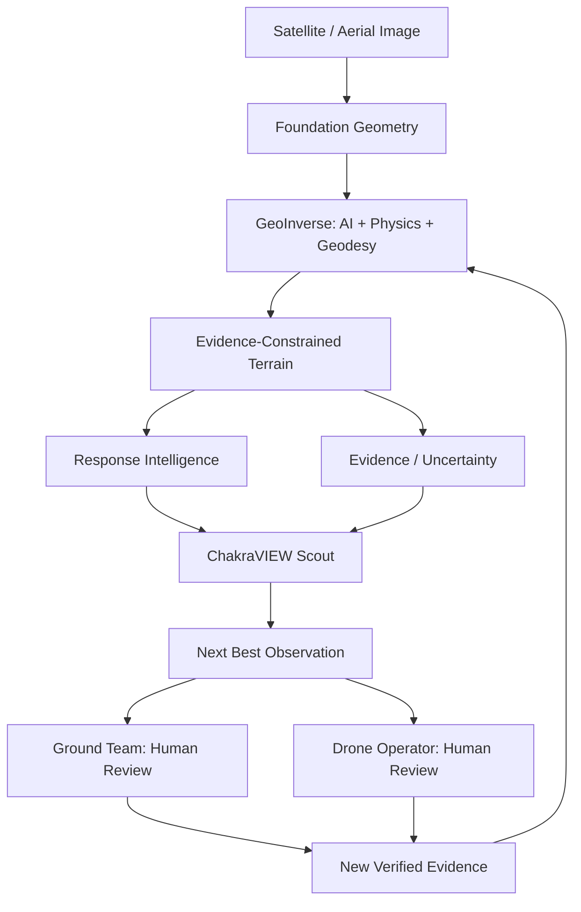

# ChakraVIEW Scout — complete implementation report

SYNTHETIC ACTIVE-RECONNAISSANCE DEMO

Visible cells retain 40% uncertainty after each simulated observation. This is not a measured sensor likelihood. Independent sorties from fixed base; no path or drone flight optimization.

## Quantitative results

Coverage is unique initial uncertainty mass seen; reduction is simulated remaining uncertainty change. Weighted coverage uses initial U × R. Costs are dimensionless fixed-base sortie proxies. Random shown below is the 30-seed mean ± population SD, not a selected lucky seed.

### mountain / GROUND
Candidates: 48; precompute 0.0660s; ranking and 34 baseline runs 0.3207s.
- scout, observation 1: uncertainty coverage 38.54%; reduction 23.12%; remaining 76.88%; weighted coverage 75.72%; cost 0.605.
- scout, observation 2: uncertainty coverage 59.13%; reduction 35.48%; remaining 64.52%; weighted coverage 94.93%; cost 0.875.
- scout, observation 3: uncertainty coverage 65.22%; reduction 46.90%; remaining 53.10%; weighted coverage 98.13%; cost 1.331.
- scout, observation 5: uncertainty coverage 67.89%; reduction 49.64%; remaining 50.36%; weighted coverage 98.13%; cost 1.481.
- random, observation 1: uncertainty coverage 32.55%; reduction 19.53%; remaining 80.47%; weighted coverage 70.68%; cost 0.525.
- random, observation 2: uncertainty coverage 34.52%; reduction 20.71%; remaining 79.29%; weighted coverage 70.68%; cost 0.693.
- random, observation 3: uncertainty coverage 37.10%; reduction 22.64%; remaining 77.36%; weighted coverage 70.72%; cost 0.768.
- random, observation 5: uncertainty coverage 46.63%; reduction 36.09%; remaining 63.91%; weighted coverage 78.51%; cost 1.447.
- nearest, observation 1: uncertainty coverage 3.36%; reduction 2.02%; remaining 97.98%; weighted coverage 0.00%; cost 0.075.
- nearest, observation 2: uncertainty coverage 3.83%; reduction 3.04%; remaining 96.96%; weighted coverage 0.00%; cost 0.150.
- nearest, observation 3: uncertainty coverage 4.52%; reduction 3.88%; remaining 96.12%; weighted coverage 0.04%; cost 0.225.
- nearest, observation 5: uncertainty coverage 4.94%; reduction 4.47%; remaining 95.53%; weighted coverage 0.20%; cost 0.468.
- highest, observation 1: uncertainty coverage 9.62%; reduction 5.77%; remaining 94.23%; weighted coverage 4.12%; cost 0.309.
- highest, observation 2: uncertainty coverage 24.42%; reduction 15.02%; remaining 84.98%; weighted coverage 11.15%; cost 0.950.
- highest, observation 3: uncertainty coverage 27.65%; reduction 18.15%; remaining 81.85%; weighted coverage 11.17%; cost 1.220.
- highest, observation 5: uncertainty coverage 52.02%; reduction 40.05%; remaining 59.95%; weighted coverage 48.56%; cost 2.223.
- Random 30-seed weighted coverage at 1: 15.36% ± 23.79%.
- Random 30-seed weighted coverage at 3: 46.97% ± 28.70%.
- Random 30-seed weighted coverage at 5: 70.51% ± 24.34%.

Top point: [500152.5, 4499877.5], Views 38.54% of remaining uncertainty mass and 395 newly observed cells hidden from initial view. Cost 0.605.
Score terms: {"information_gain": 0.7571655624954501, "relevance_gain": 0.6091769636914116, "occlusion_gain": 0.7571655624954501, "uncertainty_reduction_potential": 0.23124573864550288, "observation_cost": 0.6046693311223913}
Weighted contributions: {"information_gain": 0.7571655624954501, "relevance_gain": 0.09137654455371173, "occlusion_gain": 0.22714966874863501, "uncertainty_reduction_potential": 0.046249147729100576, "observation_cost": -0.09070039966835869}

### mountain / AERIAL
Candidates: 48; precompute 0.0709s; ranking and 34 baseline runs 0.3080s.
- scout, observation 1: uncertainty coverage 67.17%; reduction 40.30%; remaining 59.70%; weighted coverage 90.79%; cost 1.290.
- scout, observation 2: uncertainty coverage 81.43%; reduction 58.99%; remaining 41.01%; weighted coverage 98.79%; cost 2.579.
- scout, observation 3: uncertainty coverage 85.71%; reduction 62.65%; remaining 37.35%; weighted coverage 98.89%; cost 3.487.
- scout, observation 5: uncertainty coverage 85.75%; reduction 64.59%; remaining 35.41%; weighted coverage 98.90%; cost 5.304.
- random, observation 1: uncertainty coverage 52.83%; reduction 31.70%; remaining 68.30%; weighted coverage 79.85%; cost 1.358.
- random, observation 2: uncertainty coverage 55.18%; reduction 45.03%; remaining 54.97%; weighted coverage 80.46%; cost 2.796.
- random, observation 3: uncertainty coverage 61.34%; reduction 54.13%; remaining 45.87%; weighted coverage 80.70%; cost 4.086.
- random, observation 5: uncertainty coverage 71.41%; reduction 61.88%; remaining 38.12%; weighted coverage 87.26%; cost 5.995.
- nearest, observation 1: uncertainty coverage 5.04%; reduction 3.02%; remaining 96.98%; weighted coverage 0.01%; cost 0.908.
- nearest, observation 2: uncertainty coverage 5.53%; reduction 4.50%; remaining 95.50%; weighted coverage 0.01%; cost 1.817.
- nearest, observation 3: uncertainty coverage 8.08%; reduction 6.64%; remaining 93.36%; weighted coverage 2.34%; cost 2.725.
- nearest, observation 5: uncertainty coverage 9.64%; reduction 8.33%; remaining 91.67%; weighted coverage 4.85%; cost 4.634.
- highest, observation 1: uncertainty coverage 48.43%; reduction 29.06%; remaining 70.94%; weighted coverage 60.78%; cost 1.143.
- highest, observation 2: uncertainty coverage 84.72%; reduction 55.38%; remaining 44.62%; weighted coverage 88.14%; cost 2.617.
- highest, observation 3: uncertainty coverage 86.16%; reduction 62.69%; remaining 37.31%; weighted coverage 88.15%; cost 3.720.
- highest, observation 5: uncertainty coverage 90.81%; reduction 81.89%; remaining 18.11%; weighted coverage 95.81%; cost 6.389.
- Random 30-seed weighted coverage at 1: 25.17% ± 28.65%.
- Random 30-seed weighted coverage at 3: 69.49% ± 33.25%.
- Random 30-seed weighted coverage at 5: 90.72% ± 19.27%.

Top point: [500092.5, 4499877.5], Views 67.17% of remaining uncertainty mass and 938 newly observed cells hidden from initial view. Cost 1.290.
Score terms: {"information_gain": 0.9079256484259766, "relevance_gain": 0.9059642444933214, "occlusion_gain": 0.907799888892478, "uncertainty_reduction_potential": 0.4030404337254092, "observation_cost": 1.2895405231056998}
Weighted contributions: {"information_gain": 0.9079256484259766, "relevance_gain": 0.1358946366739982, "occlusion_gain": 0.2723399666677434, "uncertainty_reduction_potential": 0.08060808674508185, "observation_cost": -0.19343107846585497}

### urban / GROUND
Candidates: 36; precompute 0.0533s; ranking and 34 baseline runs 0.2254s.
- scout, observation 1: uncertainty coverage 34.31%; reduction 20.59%; remaining 79.41%; weighted coverage 47.00%; cost 0.546.
- scout, observation 2: uncertainty coverage 61.92%; reduction 37.84%; remaining 62.16%; weighted coverage 63.05%; cost 1.151.
- scout, observation 3: uncertainty coverage 68.77%; reduction 42.58%; remaining 57.42%; weighted coverage 68.13%; cost 1.318.
- scout, observation 5: uncertainty coverage 79.65%; reduction 56.42%; remaining 43.58%; weighted coverage 74.55%; cost 2.085.
- random, observation 1: uncertainty coverage 30.87%; reduction 18.52%; remaining 81.48%; weighted coverage 43.27%; cost 0.605.
- random, observation 2: uncertainty coverage 39.66%; reduction 23.98%; remaining 76.02%; weighted coverage 43.45%; cost 0.772.
- random, observation 3: uncertainty coverage 61.39%; reduction 38.96%; remaining 61.04%; weighted coverage 49.83%; cost 1.526.
- random, observation 5: uncertainty coverage 76.29%; reduction 57.08%; remaining 42.92%; weighted coverage 66.30%; cost 2.822.
- nearest, observation 1: uncertainty coverage 4.39%; reduction 2.63%; remaining 97.37%; weighted coverage 0.22%; cost 0.075.
- nearest, observation 2: uncertainty coverage 7.02%; reduction 5.21%; remaining 94.79%; weighted coverage 0.24%; cost 0.150.
- nearest, observation 3: uncertainty coverage 9.59%; reduction 7.18%; remaining 92.82%; weighted coverage 4.01%; cost 0.225.
- nearest, observation 5: uncertainty coverage 14.15%; reduction 11.15%; remaining 88.85%; weighted coverage 4.30%; cost 0.468.
- highest, observation 1: uncertainty coverage 4.39%; reduction 2.63%; remaining 97.37%; weighted coverage 0.22%; cost 0.075.
- highest, observation 2: uncertainty coverage 7.02%; reduction 5.21%; remaining 94.79%; weighted coverage 0.24%; cost 0.150.
- highest, observation 3: uncertainty coverage 11.54%; reduction 8.77%; remaining 91.23%; weighted coverage 0.42%; cost 0.318.
- highest, observation 5: uncertainty coverage 19.62%; reduction 16.58%; remaining 83.42%; weighted coverage 1.13%; cost 0.963.
- Random 30-seed weighted coverage at 1: 11.50% ± 13.18%.
- Random 30-seed weighted coverage at 3: 34.49% ± 17.70%.
- Random 30-seed weighted coverage at 5: 51.43% ± 15.15%.

Top point: [500152.5, 4499907.5], Views 34.31% of remaining uncertainty mass and 425 newly observed cells hidden from initial view. Cost 0.546.
Score terms: {"information_gain": 0.4699673192993885, "relevance_gain": 0.43581946182467013, "occlusion_gain": 0.4699673192993885, "uncertainty_reduction_potential": 0.20585587910577857, "observation_cost": 0.5460082416960389}
Weighted contributions: {"information_gain": 0.4699673192993885, "relevance_gain": 0.06537291927370052, "occlusion_gain": 0.14099019578981656, "uncertainty_reduction_potential": 0.04117117582115572, "observation_cost": -0.08190123625440583}

### urban / AERIAL
Candidates: 48; precompute 0.0721s; ranking and 34 baseline runs 0.3026s.
- scout, observation 1: uncertainty coverage 65.47%; reduction 39.28%; remaining 60.72%; weighted coverage 79.47%; cost 1.358.
- scout, observation 2: uncertainty coverage 77.16%; reduction 55.01%; remaining 44.99%; weighted coverage 90.87%; cost 2.695.
- scout, observation 3: uncertainty coverage 84.63%; reduction 60.88%; remaining 39.12%; weighted coverage 97.70%; cost 3.696.
- scout, observation 5: uncertainty coverage 86.69%; reduction 64.84%; remaining 35.16%; weighted coverage 97.70%; cost 5.512.
- random, observation 1: uncertainty coverage 49.76%; reduction 29.86%; remaining 70.14%; weighted coverage 75.50%; cost 1.379.
- random, observation 2: uncertainty coverage 59.05%; reduction 40.94%; remaining 59.06%; weighted coverage 77.04%; cost 2.693.
- random, observation 3: uncertainty coverage 63.22%; reduction 44.35%; remaining 55.65%; weighted coverage 77.24%; cost 3.601.
- random, observation 5: uncertainty coverage 89.29%; reduction 66.61%; remaining 33.39%; weighted coverage 90.31%; cost 6.127.
- nearest, observation 1: uncertainty coverage 5.87%; reduction 3.52%; remaining 96.48%; weighted coverage 0.22%; cost 0.908.
- nearest, observation 2: uncertainty coverage 8.48%; reduction 6.46%; remaining 93.54%; weighted coverage 0.25%; cost 1.817.
- nearest, observation 3: uncertainty coverage 11.26%; reduction 8.69%; remaining 91.31%; weighted coverage 4.55%; cost 2.725.
- nearest, observation 5: uncertainty coverage 19.15%; reduction 15.17%; remaining 84.83%; weighted coverage 6.86%; cost 4.634.
- highest, observation 1: uncertainty coverage 30.65%; reduction 18.39%; remaining 81.61%; weighted coverage 28.01%; cost 1.208.
- highest, observation 2: uncertainty coverage 39.82%; reduction 29.44%; remaining 70.56%; weighted coverage 38.63%; cost 2.522.
- highest, observation 3: uncertainty coverage 57.49%; reduction 44.56%; remaining 55.44%; weighted coverage 74.98%; cost 3.759.
- highest, observation 5: uncertainty coverage 82.49%; reduction 67.80%; remaining 32.20%; weighted coverage 93.74%; cost 6.333.
- Random 30-seed weighted coverage at 1: 26.35% ± 26.15%.
- Random 30-seed weighted coverage at 3: 69.13% ± 23.86%.
- Random 30-seed weighted coverage at 5: 87.86% ± 12.09%.

Top point: [500122.5, 4499877.5], Views 65.47% of remaining uncertainty mass and 856 newly observed cells hidden from initial view. Cost 1.358.
Score terms: {"information_gain": 0.7947317940271982, "relevance_gain": 0.7581237433149263, "occlusion_gain": 0.7929579695281844, "uncertainty_reduction_potential": 0.39279632850105933, "observation_cost": 1.3583333333333334}
Weighted contributions: {"information_gain": 0.7947317940271982, "relevance_gain": 0.11371856149723894, "occlusion_gain": 0.2378873908584553, "uncertainty_reduction_potential": 0.07855926570021188, "observation_cost": -0.20375000000000001}

### mixed / GROUND
Candidates: 48; precompute 0.0694s; ranking and 34 baseline runs 0.3049s.
- scout, observation 1: uncertainty coverage 41.58%; reduction 24.95%; remaining 75.05%; weighted coverage 46.00%; cost 0.605.
- scout, observation 2: uncertainty coverage 56.20%; reduction 35.02%; remaining 64.98%; weighted coverage 84.26%; cost 1.209.
- scout, observation 3: uncertainty coverage 72.99%; reduction 45.60%; remaining 54.40%; weighted coverage 92.97%; cost 1.850.
- scout, observation 5: uncertainty coverage 80.50%; reduction 51.49%; remaining 48.51%; weighted coverage 94.27%; cost 2.093.
- random, observation 1: uncertainty coverage 23.19%; reduction 13.92%; remaining 86.08%; weighted coverage 43.30%; cost 0.754.
- random, observation 2: uncertainty coverage 24.36%; reduction 14.61%; remaining 85.39%; weighted coverage 44.06%; cost 0.829.
- random, observation 3: uncertainty coverage 44.59%; reduction 26.76%; remaining 73.24%; weighted coverage 47.26%; cost 1.204.
- random, observation 5: uncertainty coverage 66.33%; reduction 43.43%; remaining 56.57%; weighted coverage 63.57%; cost 2.060.
- nearest, observation 1: uncertainty coverage 0.47%; reduction 0.28%; remaining 99.72%; weighted coverage 0.05%; cost 0.075.
- nearest, observation 2: uncertainty coverage 1.34%; reduction 0.88%; remaining 99.12%; weighted coverage 0.11%; cost 0.150.
- nearest, observation 3: uncertainty coverage 1.90%; reduction 1.32%; remaining 98.68%; weighted coverage 0.81%; cost 0.225.
- nearest, observation 5: uncertainty coverage 7.45%; reduction 5.30%; remaining 94.70%; weighted coverage 3.15%; cost 0.468.
- highest, observation 1: uncertainty coverage 17.93%; reduction 10.76%; remaining 89.24%; weighted coverage 2.25%; cost 0.456.
- highest, observation 2: uncertainty coverage 53.22%; reduction 32.00%; remaining 68.00%; weighted coverage 41.83%; cost 0.981.
- highest, observation 3: uncertainty coverage 55.83%; reduction 33.85%; remaining 66.15%; weighted coverage 42.07%; cost 1.149.
- highest, observation 5: uncertainty coverage 66.22%; reduction 45.14%; remaining 54.86%; weighted coverage 75.32%; cost 2.507.
- Random 30-seed weighted coverage at 1: 12.10% ± 14.42%.
- Random 30-seed weighted coverage at 3: 37.91% ± 18.19%.
- Random 30-seed weighted coverage at 5: 56.16% ± 17.71%.

Top point: [500062.5, 4499817.5], Views 41.58% of remaining uncertainty mass and 597 newly observed cells hidden from initial view. Cost 0.605.
Score terms: {"information_gain": 0.4599549055986875, "relevance_gain": 0.5598407705381815, "occlusion_gain": 0.45743592757756263, "uncertainty_reduction_potential": 0.2494803919973823, "observation_cost": 0.6046693311223913}
Weighted contributions: {"information_gain": 0.4599549055986875, "relevance_gain": 0.08397611558072722, "occlusion_gain": 0.1372307782732688, "uncertainty_reduction_potential": 0.04989607839947646, "observation_cost": -0.09070039966835869}

### mixed / AERIAL
Candidates: 48; precompute 0.0710s; ranking and 34 baseline runs 0.3057s.
- scout, observation 1: uncertainty coverage 72.67%; reduction 43.60%; remaining 56.40%; weighted coverage 93.05%; cost 1.358.
- scout, observation 2: uncertainty coverage 83.75%; reduction 53.66%; remaining 46.34%; weighted coverage 98.10%; cost 2.359.
- scout, observation 3: uncertainty coverage 84.09%; reduction 56.80%; remaining 43.20%; weighted coverage 98.10%; cost 3.268.
- scout, observation 5: uncertainty coverage 84.14%; reduction 58.15%; remaining 41.85%; weighted coverage 98.10%; cost 5.084.
- random, observation 1: uncertainty coverage 54.56%; reduction 32.74%; remaining 67.26%; weighted coverage 83.09%; cost 1.508.
- random, observation 2: uncertainty coverage 78.00%; reduction 51.64%; remaining 48.36%; weighted coverage 84.86%; cost 2.845.
- random, observation 3: uncertainty coverage 82.12%; reduction 58.95%; remaining 41.05%; weighted coverage 85.31%; cost 3.949.
- random, observation 5: uncertainty coverage 89.66%; reduction 76.07%; remaining 23.93%; weighted coverage 95.53%; cost 6.146.
- nearest, observation 1: uncertainty coverage 6.08%; reduction 3.65%; remaining 96.35%; weighted coverage 0.23%; cost 0.908.
- nearest, observation 2: uncertainty coverage 10.85%; reduction 7.96%; remaining 92.04%; weighted coverage 0.43%; cost 1.817.
- nearest, observation 3: uncertainty coverage 14.01%; reduction 10.93%; remaining 89.07%; weighted coverage 4.99%; cost 2.725.
- nearest, observation 5: uncertainty coverage 22.64%; reduction 18.79%; remaining 81.21%; weighted coverage 8.17%; cost 4.634.
- highest, observation 1: uncertainty coverage 73.68%; reduction 44.21%; remaining 55.79%; weighted coverage 90.03%; cost 1.290.
- highest, observation 2: uncertainty coverage 86.39%; reduction 66.23%; remaining 33.77%; weighted coverage 94.64%; cost 2.648.
- highest, observation 3: uncertainty coverage 89.09%; reduction 70.64%; remaining 29.36%; weighted coverage 94.72%; cost 3.649.
- highest, observation 5: uncertainty coverage 89.32%; reduction 80.10%; remaining 19.90%; weighted coverage 94.72%; cost 6.674.
- Random 30-seed weighted coverage at 1: 27.02% ± 26.60%.
- Random 30-seed weighted coverage at 3: 71.98% ± 26.78%.
- Random 30-seed weighted coverage at 5: 91.89% ± 13.62%.

Top point: [500122.5, 4499877.5], Views 72.67% of remaining uncertainty mass and 965 newly observed cells hidden from initial view. Cost 1.358.
Score terms: {"information_gain": 0.9305102136385053, "relevance_gain": 0.8864830929483163, "occlusion_gain": 0.9305102136385053, "uncertainty_reduction_potential": 0.4360489745677147, "observation_cost": 1.3583333333333334}
Weighted contributions: {"information_gain": 0.9305102136385053, "relevance_gain": 0.13297246394224743, "occlusion_gain": 0.27915306409155155, "uncertainty_reduction_potential": 0.08720979491354294, "observation_cost": -0.20375000000000001}

## Reproduction and architecture

See README.md for all formulations, architecture, limitations and real-world validation protocol; integration documents for contracts; PPT notes for defensible claims. results.json contains every top-five explanation and complete baseline trajectory.
Total runtime: 2.1871s.

No production modification. No foundation model training. No GeoInverse modification. No canonical pilot changes. No commit. No push.

---

## Included document: README.md

# ChakraVIEW Scout

From Passive Maps to Active Reconnaissance. Isolated offline research prototype on `research/geoguard-sprint`, not production, autonomous disaster command, a safe navigation service or a drone autopilot.

## Files and reproduction

- `scout.py`: evidence fusion, relevance, candidate constraints, 2.5D viewshed, score decomposition, sequential policies and local field evidence update.
- `demo.py`: three deterministic fixtures, two observation modes, four policies, 30 random seeds, result/report/mobile generation.
- `test_scout.py`: algorithm and safety regression tests.
- `test_mobile.cjs`: generated interface JavaScript/control tests using a DOM stub (not visual rendering).
- `mobile_template.html`: offline mobile/tablet concept template.
- `outputs/results.json`: full measured benchmark results, source attribution, top five points, scores, trajectories, maps and timings.
- `outputs/mobile_demo.html`: self-contained generated interface, no server, network or OpenAI dependency.
- `REPORT.md`: generated quantitative results at observations 1, 2, 3 and 5.
- Integration, offline, PPT and field-contract documents alongside this README.

From the repository root, using the already-installed research runtime:

```powershell
& 'research/geoguard/.venv/Scripts/python.exe' 'research/geoguard/residual/run_python.py' -m pytest research/geoguard/chakraview_scout/test_scout.py -q
& 'research/geoguard/.venv/Scripts/python.exe' 'research/geoguard/residual/run_python.py' research/geoguard/chakraview_scout/demo.py
node research/geoguard/chakraview_scout/test_mobile.cjs
```

Portable alternative: install nothing automatically; use an existing Python environment with NumPy (algorithm/demo) and pytest (tests), then run `python demo.py` from this directory. Canonical pilot inputs are not read or changed. Generated outputs are synthetic only.

## Architecture and formulations

All arrays must share one north-up, square-cell grid. Caller supplies known geospatial coordinates and verified metre units for metric use. The prototype does not reproject, infer vertical units or load ambiguous CRS data. Relative mode is explicitly labelled grid units, not metres; physical slopes cannot constrain relative terrain. Coordinates are cell centres, x increases east, y decreases with row index.

1. **Mission uncertainty U:** weighted mean of available, named, finite [0,1] evidence layers: U = sum(w_e E_e) / sum(w_e). No evidence is silently created. Caller must normalize quantities and state the scale; U is an evidence-support index, not a calibrated probability. Missing all sources fails. Optional actual nodata can be supplied as evidence; unknown terrain remains unobservable with this conservative LOS implementation. Demo explicitly sets nodata uncertainty to 1.
2. **Operational relevance R:** same named-layer fusion for supplied response attention, traversability difficulty, corridor/target/staging proximity. Optional change adds `clip(R + w_change C, 0, 1)`. R is NOT disaster severity. Demo uses synthetic corridor and target-distance functions; it does not implement Ayush's response analytics.
3. **Candidates:** deterministic lattice at configurable stride. Both modes require valid terrain. Ground requires supplied reachability and may consume allowed/traversability masks and metric slope threshold; no internal route solver. Aerial candidates have height above the local surface and an optional allowed mask (caller supplies restrictions). No obstacle-safe airspace or vehicle dynamics claims.
4. **Viewshed V_p:** for each candidate, ray from surface + observer height to every valid target cell centre. Sample at <= half-cell Chebyshev intervals, nearest-cell terrain height; sample above the ray blocks it. Unknown intermediate cells conservatively block it. Optional radius is horizontal Euclidean distance. Source/target footprints do not self-occlude endpoints. This is an approximate, finite-grid 2.5D LOS model, not GDAL's exact implementation or a supercover guarantee. No façades, overhangs, lens/FOV, refraction or Earth curvature.
5. **Information gain proxy:** `IG = sum(V U R N) / sum(U0 R)`, N = 1 for cells not yet observed in this run. This is NOT Shannon entropy or a Bayesian expected-information-gain estimate.
6. **Relevance gain:** `RG = sum(V R N) / sum(R)`.
7. **Occlusion gain:** `OG = sum(V U R N (1 - V_initial)) / sum(U0 R)`. Initial visibility is geometry visibility, not an assumed confidence update.
8. **Uncertainty-reduction potential:** `UR = (1-rho) sum(V U) / sum(U0)`. Rho is supplied observation-retention assumption, not empirically fitted sensor accuracy. Denominators stay fixed across a mission; epsilon handles empty masses safely.
9. **Observation cost:** ground = supplied accumulated cost from fixed base at candidate (caller must normalize). Aerial = distance/base-grid diagonal + height/altitude_scale. Cost is dimensionless, interpretable, not battery-optimal. Each step is an independent sortie from a fixed base; cost is summed across sorties, NOT a continuous inter-viewpoint itinerary. Height and altitude_scale use the same units in relative mode.
10. **Objective:** `Score = 1 IG + .15 RG + .30 OG + .20 UR - .15 Cost` by default. Every weight configurable. Correlated gain terms deliberately overlap; ablate and tune on development data only. All raw and weighted terms exported. Deterministic tie breaks use candidate index.
11. **Sequential loop:** score unused points using current U and novelty; choose highest score; simulate `U[V] *= rho` (demo rho=.4); mark visible cells observed; repeat, excluding used points. Repeated coverage can further reduce simulated U but does not count again as unique coverage. This update is an explicit simulation, not a real evidence assimilation claim. Production field updates must use verified evidence footprints/quality.

## Quantitative evaluation

Mountain: ridge, valleys, relief and hidden cells. Urban-like: raised blocks/corridors (not building façades). Mixed: ridge, synthetic response corridor, staging/base and uncertainty patch. All 40x40 at 5 m in local synthetic metric coordinates; each contains a small nodata patch. Candidate stride 6 cells, radius 100 m; ground height 1.7 m, aerial height 25 m. Fixture reachability/cost layers are labelled synthetic, not independently computed safe access.

All strategies use identical candidates, viewsheds, uncertainty, relevance, retention and fixed-base cost. Random runs 30 seeds 0–29; an additional seed42 trajectory is explicitly labelled for display. Nearest uses planar distance to fixed base, highest uses observer elevation. Scout may lose on some metrics/settings; do not infer guaranteed dominance. Read REPORT.md/results.json for exact coverage, reduction, cost and runtime per scenario, mode and observation count. Runtime includes precomputation and ranking separately, is machine-specific, and is not a mobile-device benchmark.

Unique uncertainty coverage = sum(U0 * union visibility) / sum(U0). Operational weighted coverage = sum(U0 R * union visibility) / sum(U0 R). Remaining = sum(U_t)/sum(U0); reduction = sum(U0-U_t)/sum(U0). These are distinct metrics; they are not disaster severity, mission confidence, recovered height accuracy or calibrated posterior uncertainty. Invalid cells remain in the uncertainty denominator and cannot be claimed observed.

## Research inspiration

The innovation claim is application-level integration of established next-best-view/active perception and terrain visibility into evidence-constrained response prioritization, not invention of NBV. Primary sources:

- Bircher et al., *Receding Horizon “Next–Best–View” Planner for 3D Exploration* (2016), [author repository](https://github.com/ethz-asl/nbvplanner). Scout is a simpler greedy raster proxy, not a reproduction of their 3D planner.
- [GDAL viewshed documentation](https://gdal.org/en/stable/programs/gdal_raster_viewshed.html) for established terrain viewshed context. Scout's LOS kernel is independently implemented and approximate.

## Exact future real-world validation

Before accessing held-out measurements, preregister a protocol on at least three independent, noncanonical sites representing mountainous, built-up and mixed environments. Freeze AOIs, verified vertical/horizontal units, input terrain/response layers, access masks, sensor range/FOV/no-fly restrictions, candidate grid, weights, retention model and comparator definitions using development sites only. Keep audit truth inaccessible to planning. Have a supervised ground team/drone operator gather one observation at each nominated viewpoint using equal time/budget and safety approvals; randomize strategy/site order and compare independent campaigns to avoid sharing newly collected evidence between policies. Use a reference LiDAR/photogrammetry surface withheld from selection plus adjudicated visibility/access observations solely for evaluation. Measure actual newly verified high-relevance area, calibration of evidence reduction, terrain error before/after, visibility precision/recall, observation time, failed/inaccessible recommendations and operator agreement after 1/3/5 observations. Report paired site-level intervals and random seeds, not cell-independent confidence intervals; do not tune on withheld outcomes. First validate LOS against surveyed targets and a trusted viewshed implementation. Operational safety decisions remain human-controlled.

## Limitations and deliverable status

Prototype implemented and synthetic-tested; no field validation. Finite-grid LOS can miss thin/corner obstacles; uncertain terrain can distort viewsheds. No sensor likelihood, camera footprint, safety-route proof, semantic disaster labels, autonomous control or mobile deployment. Candidate density, scale normalization and weights influence outcomes. No production UI/API changes. GeoInverse/Response Intelligence integration is a documented array contract, not a live connection. Mobile interface is an offline concept: working scenario/step controls and local note queue, not an installed responder app; terrain view is 2D and navigation is informational only.

NO PRODUCTION MODIFICATION / NO FOUNDATION MODEL TRAINING / NO GEOINVERSE MODIFICATION / NO CANONICAL DATA MODIFICATION / NO COMMIT / NO PUSH.


---

## Included document: GEOINVERSE_INTEGRATION.md

# GeoInverse / Response Intelligence integration contract

No existing GeoInverse, Manish audit or Ayush module is modified. Caller supplies aligned arrays plus grid, CRS, verified units, validity, source/version/hash and timestamps. Reject grid mismatch, missing units and unavailable evidence rather than infer metre accuracy from a projected CRS.

Evidence registry mappings, only when genuinely supplied:

- low evidence coverage -> 1 - normalized coverage;
- missing/remote anchors -> normalized distance to valid anchors (caller defines distance saturation in metres);
- shadow disagreement -> documented normalized residual, NOT raw signed residual;
- foundation/reference disagreement -> normalized absolute disagreement, explicitly a proxy, not posterior model uncertainty;
- supplied predictive uncertainty -> documented calibration/scale and source, never fabricated.

Pass those named [0,1] arrays to `evidence_map`. Preserve unavailable sources as absent, not zero confidence claims. Response Intelligence can supply relevance arrays, reachable/allowed masks and accumulated fixed-base access cost. It owns slope, roughness, routes, staging and attention; Scout consumes rather than recreates these. A ground candidate with no known reachability/cost must be rejected.

Registry -> U -> ranked observation -> human acceptance -> actual measured observation with footprint/quality -> GeoInverse evidence registry -> a separately authorized GeoInverse update -> refreshed geometry/evidence -> rerank. Marking a point observed alone does not recover metric gauge or authorize model updates. In simulation only, visible cells use an assumed retention multiplier. Real field observations default to no uncertainty reduction unless quality/footprint is supplied and verified.

Anchor measurements need unit, datum, CRS, uncertainty, instrument and coordinate metadata. Photos need optional opaque photo_reference and consent/privacy handling; no victim/facial identification. New evidence is not calibration truth automatically. Retain evaluation splits; do not use withheld truth for ranking.


---

## Included document: CHANGE_DETECTION_INTEGRATION.md

# Optional change-aware relevance

“Change detection identifies where something changed. ChakraVIEW Scout decides which changed/uncertain location should be observed first.”

Input: `change_score[y,x]`, finite [0,1], same grid, with modality (pre/post optical, SAR or supplied foundation output), source/model/version, acquisition timestamps, validity and normalization metadata. Caller handles clouds, registration and known artefacts; missing/invalid pixels must not be silently labelled unchanged. No change detector is trained here.

`relevance_map(..., change_score=C, change_weight=w)` computes `clip(R_existing + w C, 0, 1)` and records the source. Prototype expects finite aligned input; caller must explicitly restrict valid mission support or reject missing values. Change is not disaster severity or proof of damage. Freeze w on development data; evaluate its usefulness independently. No production API or contracts are changed.


---

## Included document: OFFLINE_MOBILE_ARCHITECTURE.md

# Offline-first concept

Cache a versioned mission package: verified terrain tiles/grid/units, evidence layers/source registry, response layers, supplied routes/access masks, candidate recommendations/score decomposition, and evidence JSON with hashes/timestamps. Compute locally using bounded AOI/tile/resolution; this NumPy research implementation is not yet a browser/phone kernel. Desktop outputs are self-contained HTML; no OpenAI API, cloud or network required.

Device UI: show evidence-support indicators (not calibrated mission confidence), unknown terrain, top five recommendations, costs and explanations; require human review. Terrain tiles and recommendations must advertise their age and source. Queue field observations locally with UUID, timestamp/location accuracy, status and optional photo_reference; avoid faces/victim identification. Replay idempotently after connection returns, preserve conflicts and audit records; no last-write-wins replacement of terrain truth. Real deployment requires encrypted storage, operator consent, purge policy, authenticated synchronization and safe access controls; not implemented here.

Mobile concept implemented: scenario/mode switch, sequential simulation, computed coverage/remaining index, score terms, baseline results, terrain plan-view, informational access button and browser-local note queue. 3D integration/navigation and server synchronization are intentionally not connected. Notes do not silently change scientific evidence. A refresh may preserve notes but resets demo step; recommend explicit mission package state persistence in a future authorized deployment.


---

## Included document: CHAKRAVIEW_SCOUT_PPT_NOTES.md

# CHAKRAVIEW SCOUT

## From Passive Maps to Active Reconnaissance

“ChakraVIEW does not only tell responders what is known. It tells them what should be observed next.”

“Every new observation is chosen to reduce the most operationally important uncertainty.”

Qualification: chosen by a configurable proxy objective among supplied safe/reachable candidate points, not guaranteed global optimum or autonomous disaster command.

Research inspiration: NEXT-BEST-VIEW + ACTIVE PERCEPTION + TERRAIN VIEWSHED + FIRST-RESPONDER INTELLIGENCE. We did not invent NBV. Proposed innovation is integrating evidence-constrained terrain, response layers, explainable selection and new field evidence into ChakraVIEW's satellite-to-response pipeline.

Hero visual: open outputs/mobile_demo.html, choose mountain or urban, advance 0 -> 1 -> 3 -> 5; display weighted coverage alongside remaining uncertainty, not “mission confidence”. All slides containing these visuals must say SYNTHETIC ACTIVE-RECONNAISSANCE DEMO. Use REPORT.md/results.json numbers verbatim; report the 30-seed random mean/SD and identify ground/aerial mode, range and retention assumption. Do not cherry-pick one random seed. Comparisons show software behavior, not field accuracy or rescue outcomes.

Defensible selling points: interpretable per-viewpoint scores; terrain-occlusion reward; supplied access constraints; evidence-source transparency; locally runnable planning; explicit handoff to human ground/drone operators; no cloud/OpenAI dependency. Architecture.mmd shows the proposed integration, not all live deployed connections.

Not defensible yet: novel foundation model, calibrated confidence, autonomous response, battery-optimal drone plan, façade reconstruction, real landslide prediction, safe route guarantee or proven disaster-performance uplift. Before operational claims, run the preregistered real-world validation in README.md.


---

## Included document: VALIDATION.md

# Verification record — 2026-09-27

- Branch verified: research/geoguard-sprint.
- Python tests: 46 passed in 0.28 s (last recorded run).
- Mobile generated JavaScript tests: 40 assertions passed using Node VM/minimal DOM stub. Includes all six scenario/mode options, five observation steps, completion/disabled state, values, explanatory controls, local note queue and storage failure. This is not browser-layout/accessibility QA.
- Browser visual verification: NOT COMPLETED. Available browser policy rejected local file:// pages; no workaround attempted. User can open outputs/mobile_demo.html locally to inspect desktop/mobile layout.
- Canonical raster verification: all 20 input TIFF SHA-256 hashes match the earlier transfer manifest, zero mismatches.
- git diff --check: PASS; existing LF/CRLF warning on .gitignore only.
- Existing tracked diff: .gitignore only, untouched by this task. research/ remains untracked. Worktree is not claimed clean.
- Frozen tag unchanged: 2f85c3a9289059f8b690e761cc50b114b2f696e9.
- All authored files and generated outputs are confined to research/geoguard/chakraview_scout/. Python/pytest may also generate their ordinary cache files inside this directory.
- No production modification, foundation training, GeoInverse modification, canonical data modification, commit or push.

Algorithm tests cover flat LOS, ridge occlusion/elevated view, conservative nodata, range, boundaries, validity/reachability/slope candidate constraints, metric/relative coordinates, missing/invalid evidence, optional change, score decomposition, novelty, ground and aerial costs, unreachable costs, sequential monotonicity, random/highest/nearest policies, determinism, no repeated points, empty/zero evidence mass, no mutation, field statuses, initial occlusion and finite synthetic outputs.

Quantitative results are deterministic for fixed parameters except runtime; they demonstrate this synthetic objective/geometry behavior only. No real-world performance claim is supported yet.


## Mermaid architecture



## Field observation update contract

```json
{
  "schema_version": "research-1",
  "required": ["observation_id", "mission_id", "status", "timestamp", "location", "source"],
  "status_enum": ["OBSERVED", "BLOCKED", "CLEAR", "UNKNOWN", "NOTE"],
  "location_contract": {"row": "integer", "col": "integer", "coordinates": "optional numeric pair", "crs": "explicit", "accuracy": "optional documented units"},
  "optional": ["photo_reference", "note", "quality", "verified_footprint", "datum", "units", "instrument", "operator_review"],
  "quality": "[0,1], defaults to 0; not inferred from status",
  "update_rule": "OBSERVED/BLOCKED/CLEAR may reduce the supplied cell U by (1-quality); UNKNOWN/NOTE do not reduce it. Verified wider footprints require a separate explicit assimilation step.",
  "scope": "Research interface documentation, not a production API or JSON Schema validator. Python validates local cell/status/quality only. Browser demo queues notes only.",
  "privacy": "No facial recognition, victim identification or sensitive-data subsystem. Opaque photo references only."
}

```
